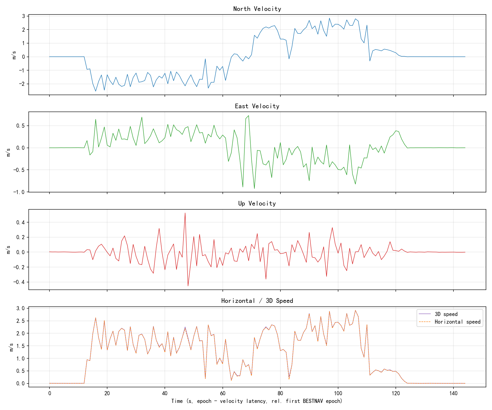
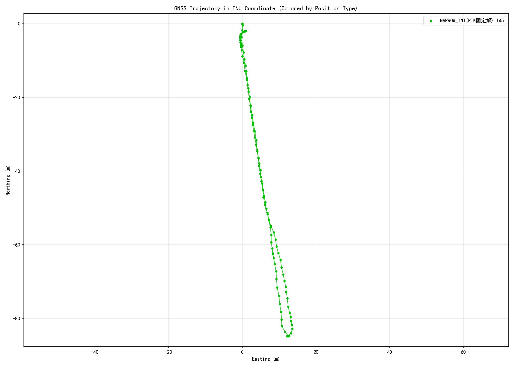

# UM980 / 北斗星通 GNSS Kinematic分析报告

- 输入：`1022树荫下动态-北斗.log`
- 生成时间：2026-10-28 19:35:17
- 协议依据：N4 Products Commands and Logs Reference Book R1.15

## 完整性与周期
说明：参考周期仅作对照，不将实测周期差异直接判错；告警基于校验和实测时间节律。

| 报文 | 条数 | 参考周期s | 实际周期s | 实际Hz | 跳变数 | 估算缺槽 | 状态 | 备注 |
|---|---:|---:|---:|---:|---:|---:|---|---|
| BESTNAVA | 145 | 0.100 | 1.000 | 1.000 | 0 | 0 | ok | 实测周期1.000s与推荐参考0.100s不一致，需结合现场配置确认 |
| GGA | 1444 | 0.100 | 0.100 | 10.000 | 0 | 0 | ok |  |
| GSA | 7396 | 0.100 | - | - | 0 | 0 | ok | 无可用时间戳，未计算周期；按实测条数呈现 |
| GRS | 23984 | 0.100 | 0.100 | 10.000 | 0 | 0 | ok |  |
| GSV | 5563 | 1.000 | - | - | 0 | 0 | ok | 无可用时间戳，未计算周期；按实测条数呈现 |
| GST | 145 | 1.000 | 1.000 | 1.000 | 0 | 0 | ok |  |
| SATSINFOA | 145 | 1.000 | 1.000 | 1.000 | 0 | 0 | ok |  |
| BESTSATA | 145 | 1.000 | 1.000 | 1.000 | 0 | 0 | ok |  |
| RTKSTATUSA | 145 | 1.000 | 1.000 | 1.000 | 0 | 0 | ok |  |
| OBSVMB | 145 | 1.000 | 1.000 | 1.000 | 0 | 0 | ok |  |

## 解类型
- 总历元：145
- 固定解率：100.0%
- NARROW_INT: 145

## 位置σ / 伪距残差
- 纬度σ中位：0.010 m
- 经度σ中位：0.009 m
- 高度σ中位：0.025 m
- GST RMS中位：0.670 m
- GRS逐星残差中位：0.300 m

## OBSVM
- 历元：145；频点观测：18443
- C/N0均值：39.333 dB-Hz；低C/N0占比：19.6%
- 失锁/消失事件：731；重捕获事件：594

## 限制
Kinematic数据无外业真值，不能计算绝对定位误差；接收机σ/RMS为自估质量指标。

## 速度与轨迹

- 水平速度均值 1.180 m/s；最大 2.918 m/s。
- 三维合速度均值 1.186 m/s；最大 2.918 m/s。
- 有效速度历元 145；未纳入 0（速度状态无效或必需字段缺失/非法）。
- 其中时间状态非FINE的速度历元 0：速度仍纳入统计，时间序列留空。
- 其中缺少有效latency的速度历元 0：保留速度统计，时间序列留空。
- 速度取自BESTNAV速度解：东/北分量由水平速度与相对真北的航迹角分解，向上速度取垂直速度；三维合速度为sqrt(水平速度²+垂直速度²)，均值为有效历元的算术平均。
- 速度时刻按FINE状态的GPS周/周内毫秒减latency校正；UNKNOWN或未识别时标不用于时间计算，差分龄期不参与速度或时间校正。位置状态与速度状态分别判断。
- ENU以首个有效WGS84坐标为参考，使用椭球高=hgt海拔高+undulation大地水准面差距；无解段断线。本报告未计算累计路程，轨迹不是精度误差。

