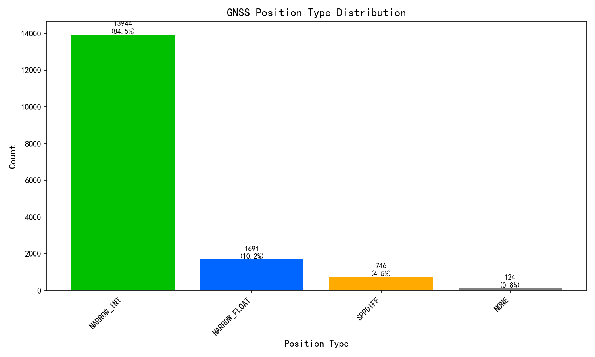
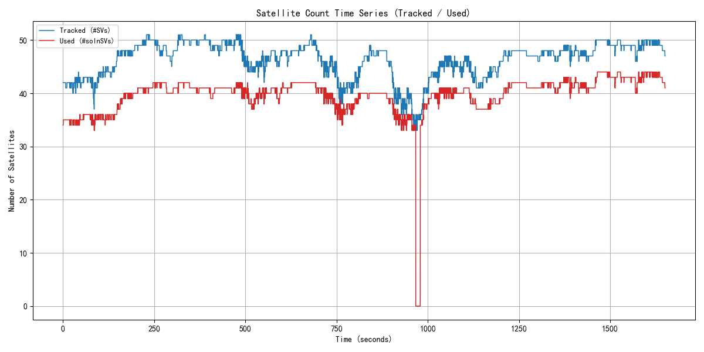
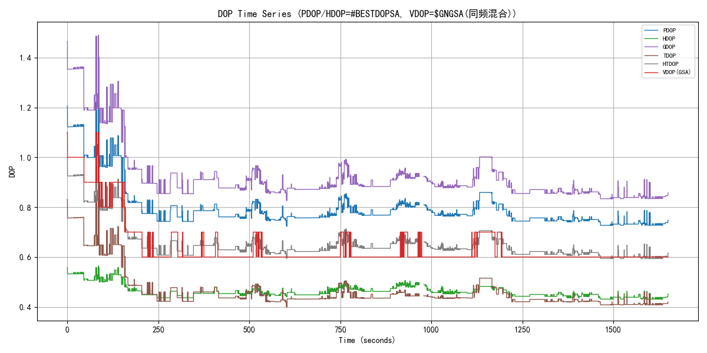
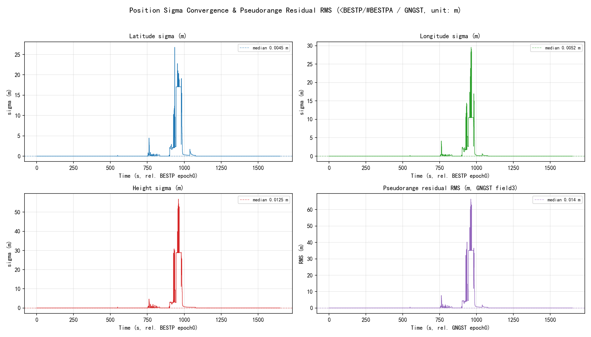
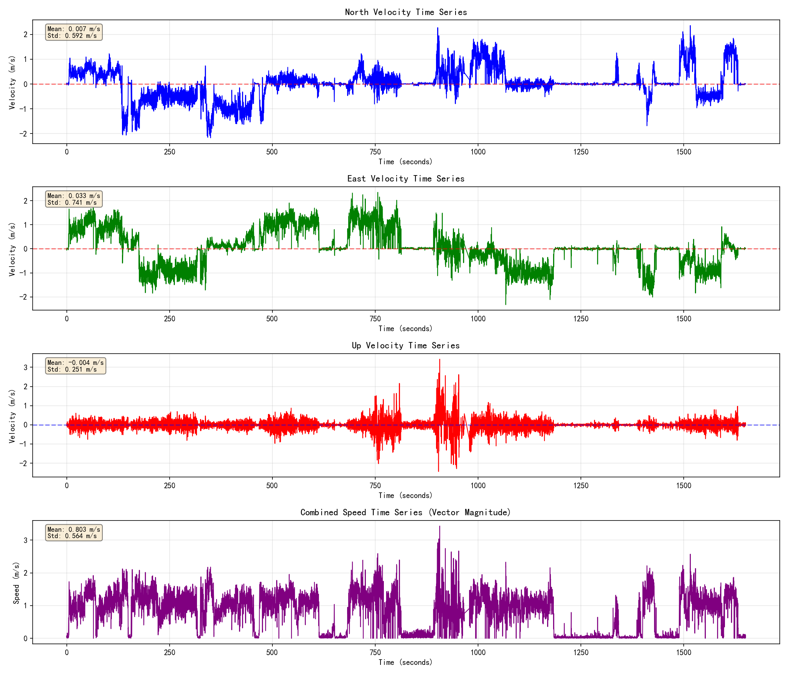
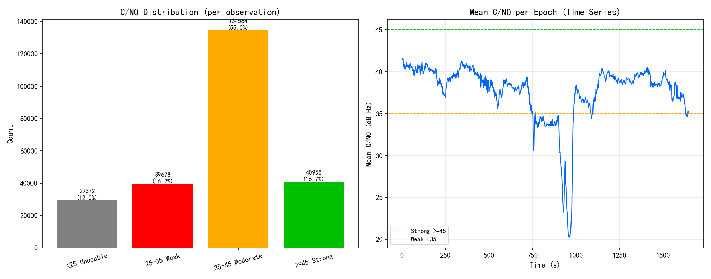
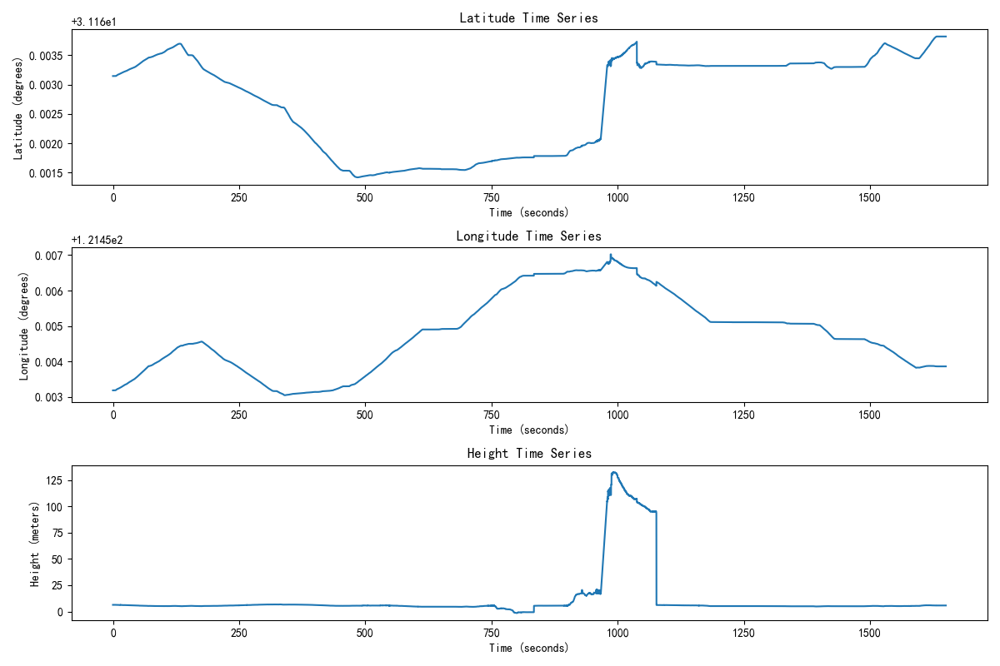
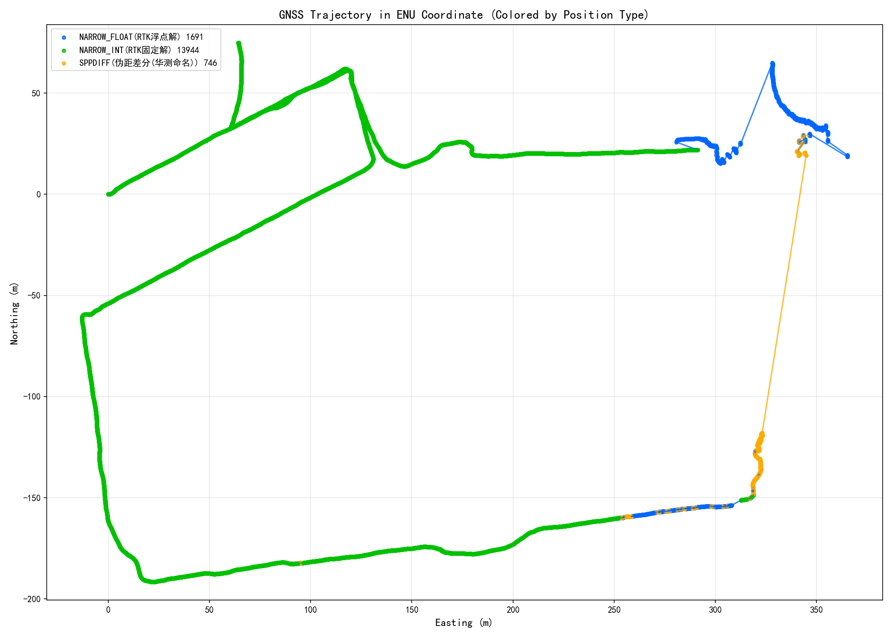
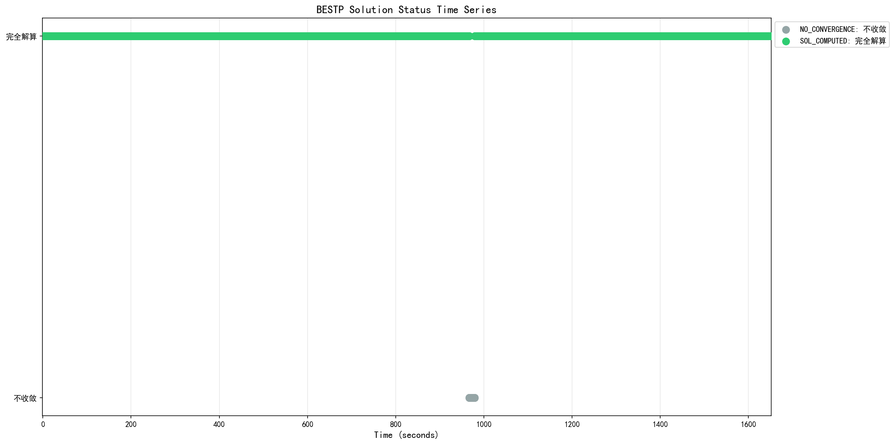

# GPS/RTK Kinematic定位分析报告【华测 HUACE · 纯GNSS】

## 基本信息
- **分析输入(COM1/ASCII)**: 0921复杂场景-华测-多log.log
- **生成时间**: 2026-09-21 15:44:02
- **分析工具**: 华测 HUACE Kinematic Analyzer

## 1. 数据概览

| 报文类型 | 数量 | 占比 |
|---------|------|------|
        | $GPGSV | 51910 | 10.3% |
| $GLGSV | 29625 | 5.9% |
| $GAGSV | 47145 | 9.3% |
| $GBGSV | 64621 | 12.8% |
| $GQGSV | 31542 | 6.2% |
| $GIGSV | 16241 | 3.2% |
| $GNGSA | 96800 | 19.2% |
| $GNGST | 16506 | 3.3% |
| #BESTDOPSA | 16506 | 3.3% |
| $GNGGA | 33011 | 6.5% |
| #BESTVA | 16505 | 3.3% |
| #ENVSTATUSA | 16495 | 3.3% |
| #FILTERDBGA | 1772 | 0.4% |
| #BESTPA | 16505 | 3.3% |
| #RANGEA | 1651 | 0.3% |
| #SATVIS2A | 13208 | 2.6% |
| $q | 10 | 0.0% |
| < | 128 | 0.0% |
| <q | 8 | 0.0% |
| #t | 1 | 0.0% |
| #1 | 1 | 0.0% |
| #RTKPA | 16505 | 3.3% |
| #RTKVA | 16505 | 3.3% |
| $= | 1 | 0.0% |
| #Kqr | 1 | 0.0% |
| $' | 2 | 0.0% |
| $ | 93 | 0.0% |
| <I | 2 | 0.0% |
| #A | 2 | 0.0% |
| #q | 8 | 0.0% |
| #BESTPOSA | 1651 | 0.3% |
| $F | 1 | 0.0% |
| # | 149 | 0.0% |
| #~ | 1 | 0.0% |
| $o1 | 1 | 0.0% |
| #r | 5 | 0.0% |
| #a) | 3 | 0.0% |
| $ga y | 1 | 0.0% |
| <C | 2 | 0.0% |
| <<q | 1 | 0.0% |
| $W | 1 | 0.0% |
| $^a | 1 | 0.0% |
| <fq | 1 | 0.0% |
| #J | 3 | 0.0% |
| $`q | 1 | 0.0% |
| 
 | 1 | 0.0% |
| $-E | 1 | 0.0% |
| #E | 2 | 0.0% |
| $aa) | 1 | 0.0% |
| $a) | 1 | 0.0% |
| <*a | 1 | 0.0% |
| $7a T | 1 | 0.0% |
| <A' | 1 | 0.0% |
| #gb | 1 | 0.0% |
| $( | 1 | 0.0% |
| <6q | 1 | 0.0% |
| $o | 1 | 0.0% |
| #2B | 1 | 0.0% |
| $_ | 1 | 0.0% |
| $yB | 1 | 0.0% |
| $v | 1 | 0.0% |
| $#BESTPA | 3 | 0.0% |
| $C= | 1 | 0.0% |
| #@ | 1 | 0.0% |
| <" | 1 | 0.0% |
| <k | 1 | 0.0% |
| <? | 1 | 0.0% |
| $> | 1 | 0.0% |
| <B | 2 | 0.0% |
| $c | 1 | 0.0% |
| #M | 1 | 0.0% |
| #Oyb | 1 | 0.0% |
| <Bq | 1 | 0.0% |
| #\mr | 1 | 0.0% |
| <> | 2 | 0.0% |
| <f | 1 | 0.0% |
| <s | 1 | 0.0% |
| #2 | 2 | 0.0% |
| <: | 1 | 0.0% |
| #9 | 1 | 0.0% |
| #3t | 1 | 0.0% |
| $" | 1 | 0.0% |
| <x | 1 | 0.0% |
| $|s K | 1 | 0.0% |
| ##BESTPA | 5 | 0.0% |
| <a)^ | 1 | 0.0% |
| #ESR | 1 | 0.0% |
| <d | 1 | 0.0% |
| #b | 2 | 0.0% |
| $$GPGSV | 1 | 0.0% |
| <#RTKPA,33.5,0,0,COM1,FINESTEERING,2437,112026800,ab0acbc1,00000000;SOL_COMPUTED,NARROW_FLOAT,WGS84,00,31.16355483396,121.45666622613,114.7718,11.0428,0.2545,0.1297,0.4752,0.800,0.800,43,40,32,35,8008,37,1f,07,00,1793*efe061e6 | 1 | 0.0% |
| $<c | 1 | 0.0% |
| #Tr | 1 | 0.0% |
| <b | 1 | 0.0% |
| #J$" | 1 | 0.0% |
| $m"3 | 1 | 0.0% |
| ##3 | 1 | 0.0% |
| <oe | 1 | 0.0% |
| <E)> | 1 | 0.0% |
| $q' | 1 | 0.0% |
| <`[q | 1 | 0.0% |
| $da | 1 | 0.0% |
| #F | 1 | 0.0% |
| #B$GNGGA | 1 | 0.0% |
| $#RTKPA | 3 | 0.0% |
| #1$GNGGA | 1 | 0.0% |
| $? | 1 | 0.0% |
| $Q( | 1 | 0.0% |
| #> | 1 | 0.0% |
| <(a | 1 | 0.0% |
| $5ca)Q | 1 | 0.0% |
| #Q(A | 1 | 0.0% |
| $q( | 2 | 0.0% |
| $! | 1 | 0.0% |
| <8 | 1 | 0.0% |
| <)R | 1 | 0.0% |
| #"q( | 1 | 0.0% |
| <9 | 1 | 0.0% |
| <*v | 1 | 0.0% |
| <4~ | 1 | 0.0% |
| #8 | 1 | 0.0% |
| $/ | 2 | 0.0% |
| <.4 | 1 | 0.0% |
| <3 | 1 | 0.0% |
| <03 | 1 | 0.0% |
| <1 | 1 | 0.0% |
| $0 | 1 | 0.0% |
| #)T | 1 | 0.0% |
| #/ | 1 | 0.0% |
| <Pr) | 1 | 0.0% |
| $V. | 1 | 0.0% |
| $R. | 1 | 0.0% |
| <"q) | 1 | 0.0% |
| $e | 1 | 0.0% |
| <* | 2 | 0.0% |
| #$GNGGA | 1 | 0.0% |
| $I2a | 1 | 0.0% |
| <=( | 1 | 0.0% |
| #' | 1 | 0.0% |
| #c' | 1 | 0.0% |
| <.# | 1 | 0.0% |
| #& | 1 | 0.0% |
| $u$ | 1 | 0.0% |
| <$GNGGA,071607.60,3109.81076961,N,12127.23915406,E,4,42,0.4,5.334,M,11.034,M,0.6,1793*52 | 1 | 0.0% |
| <Ea | 1 | 0.0% |
| $UVa | 1 | 0.0% |
| <wa | 1 | 0.0% |
| #< | 1 | 0.0% |
| $bQ 1 | 1 | 0.0% |

**数据完整性**: 505461 条有效报文(原始 1271011 行, 乱码残片 63189 行)

        
## 2. 完整性检查与报文周期核对(COM1配置)

| 报文 | 实测头 | 条数 | 设定周期(s) | 实际周期(s) | 实际频率(Hz) | 丢帧率 | 状态 | 备注 |
|------|--------|------|------------|------------|-------------|--------|------|------|
| GGA | $GNGGA | 33011 | 0.100 | 0.050 | 20.00 | 0.0% | 🟠**周期不符** | 实际周期0.050s与设定0.100s偏差50.0%, 请核对配置 |
| GSV | $GPGSV,$GLGSV,$GAGSV,$GBGSV,$GQGSV,$GIGSV,$$GPGSV | 241085 | 0.100 | - | - | - | 🟢正常 | 无可用时间戳, 按报文插入规律推断(以实测数据为准) |
| GST | $GNGST | 16506 | 0.100 | 0.100 | 10.00 | 0.0% | 🟢正常 | - |
| GSA | $GNGSA | 96800 | 0.100 | - | - | - | 🟢正常 | 无可用时间戳, 按报文插入规律推断(以实测数据为准) |
| BESTDOPSA | #BESTDOPSA | 16506 | 0.100 | 0.100 | 10.00 | 0.0% | 🟢正常 | - |
| BESTPA | #BESTPA | 16505 | 0.100 | 0.100 | 10.00 | 0.0% | 🟢正常 | - |
| RTKPA | #RTKPA | 16505 | 0.100 | 0.100 | 10.00 | 0.0% | 🟢正常 | - |
| RTKVA | #RTKVA | 16505 | 0.100 | 0.100 | 10.00 | 0.0% | 🟢正常 | - |
| BESTVA | #BESTVA | 16505 | 0.100 | 0.100 | 10.00 | 0.0% | 🟢正常 | - |
| ENVSTATUSA | #ENVSTATUSA | 16495 | 0.100 | 0.100 | 10.00 | 0.1% | 🟢正常 | - |

> ⚠️ 加粗标色项表示实际报文周期与设定周期可能不符或报文缺失, 请核对设备输出配置。

**采样率分析**: 20.00 Hz (平均间隔: 0.050 秒)

        
**RTK链路**: 基站ID 1793 (核对33次) ／ 差分龄期 平均1.00s, 最大1.00s

        
## 3. GNSS解类型分析

| 解类型 | 数量 | 占比 |
|--------|------|------|
| NARROW_INT | 13944 | 84.5% |
| NARROW_FLOAT | 1691 | 10.2% |
| SPPDIFF | 746 | 4.5% |
| NONE | 124 | 0.8% |

**GNSS固定解比率**: 84.5%

## 4. 卫星数量分析

| 指标 | 平均 | 最小 | 最大 | 口径依据(M7手册) |
|------|------|------|------|----------------------|
| 跟踪卫星数 | 46.2 | 33 | 51 | #SVs跟踪到的卫星数(M7手册BESTP字段15/p83) |
| 可用卫星数 | 39.9 | 33 | 44 | #solnSVs参与解算的卫星数(M7手册BESTP字段16/p84) |

> 两层关系: 跟踪 >= 可用。

        
## 5. DOP分析

**数据源**: PDOP/HDOP=#BESTDOPSA, VDOP=$GNGSA(同频混合)（DOP为接收机本地解算的几何精度因子，非卫星下发；多星座取组合DOP，星座越多DOP越小）

> #BESTDOPSA不含VDOP(表3-36: PDOP/GDOP/HDOP/TDOP/HTDOP); VDOP取自$GNGSA(表3-3第7字段=垂直精度因子)。两报文同为10Hz同频, 且PDOP/HDOP数值同源(GSA为1位小数舍入版), 故按字段混合使用。

| 指标 | 数值 | 评估 |
|------|------|------|
| 平均PDOP | 0.80 |  |
| 最小PDOP | 0.72 | |
| 最大PDOP | 1.23 | |
| 平均HDOP | 0.46 | 优秀 |
| 最小HDOP | 0.43 | |
| 最大HDOP | 0.56 | |
| 平均VDOP | 0.64 |  |
| 最小VDOP | 0.60 | |
| 最大VDOP | 1.10 | |
| 平均GDOP | 0.92 |  |
| 最小GDOP | 0.83 | |
| 最大GDOP | 1.49 | |
| 平均TDOP | 0.46 |  |
| 最小TDOP | 0.40 | |
| 最大TDOP | 0.85 | |
| 平均HTDOP | 0.66 |  |
| 最小HTDOP | 0.59 | |
| 最大HTDOP | 1.02 | |

        
## 6. 位置标准差σ收敛与伪距残差RMS

**数据源**: 位置σ = &lt;BESTP/#BESTPA 数据字段[8]/[9]/[10] (纬度/经度/高度标准差, M7手册 表3-38 字段10/11/12);
伪距残差RMS = $GNGST 字段3 "伪距、DGNSS修正值的标准偏差的均方根" (M7手册 3.1.5 表3-9)。单位统一 m。

σ为接收机自估精度(协方差传播), 反映解算收敛质量而非外业真值误差; 仅统计 SOL_COMPUTED 且坐标有效历元(16381历元)。
伪距残差RMS越小越好, 其抬升通常指示遮挡/多径/电离层扰动。

| 指标 | 均值 | 中位数 | 最小 | 最大 | 单位 |
|------|------|--------|------|------|------|
| 纬度标准差 σ_lat | 0.4124 | 0.0045 | 0.0034 | 26.7843 | m |
| 经度标准差 σ_lon | 0.3012 | 0.0052 | 0.0037 | 29.5699 | m |
| 高度标准差 σ_hgt | 0.6674 | 0.0125 | 0.0084 | 56.8240 | m |
| 伪距残差RMS ($GNGST field3) | 0.8489 | 0.0140 | 0.0100 | 66.4420 | m |

## 7. 速度分析

| 指标 | 数值 | 单位 |
|------|------|------|
| 平均速度 | 0.80 | m/s |
| 最大速度 | 3.43 | m/s |

        
## 8. 载噪比 C/N0 分析（特色：RANGEA）

| 指标 | 数值 | 说明 |
|------|------|------|
| 数据来源 | RANGEA | 原始观测值(伪距/载波/多普勒/载噪比), 华测独有采集 |
| 统计历元数 | 1651 | 参与统计的观测历元 |
| 观测值总数 | 244572 | 全部卫星/频点的C/N0样本数 |
| 平均C/N0 | 37.8 dB-Hz | 越高信号越好 |
| 中位数C/N0 | 40.6 dB-Hz | 抗离群值, 反映典型水平 |
| 范围 | 10 ~ 54 dB-Hz | 最低/最高观测值 |
| 低C/N0(<35)占比 | 28.2% | 占比越高遮挡/多路径越明显 |

**解读指导(行业共识, 见 Kaplan《Understanding GPS》)**: C/N0(载噪比)衡量卫星信号质量, 单位 dB-Hz, 越高越好。一般判据: **≥45** 信号强(开阔天空); **35~45** 中等(正常可用); **<35** 偏弱, 易受遮挡/多路径影响; 接收机跟踪门限约 **25~28**, 低于此值易失锁。

**怎么看图**: 上图分布直方图按阈值着色(绿=强/黄=中/红=弱), 绿色占比越高越好; 下图历元平均C/N0时间序列若某时段明显下坠, 说明该时段存在遮挡(楼宇/树荫/隧道)或强多路径。分布直方图左偏(低值尾巴长)或时间序列出现深坑, 都提示观测环境欠佳。

        
## 9. 位置分析

位置时间序列显示了接收机在Kinematic环境下的位置变化。从图中可以观察到位置的连续性和稳定性。

### 9.1 GNSS轨迹分析（ENU坐标）

GNSS轨迹图使用ENU（East-North-Up）坐标系显示，按数据实际出现的解类型动态着色（本设备GNSS解类型见上分布图；不同产品命名可能有差异，如伪距差分北云称PSRDIFF、华测称SPPDIFF，含义相同）：绿色=RTK固定解(NARROW_INT)，蓝色=浮点解(NARROW_FLOAT)，红色=单点(SINGLE)，橙色=伪距差分(PSRDIFF/SPPDIFF)，紫色=PPP，灰色=无解(NONE)。图例中标注各类型数量及中文名。

### 9.2 BESTP解算状态时间序列

该图展示了BESTP报文中解算状态（sol stat）的时间序列变化，帮助分析定位过程中解算状态的稳定性。

## 10. 结论与建议

### 评估结果

| 评估指标 | 状态 | 说明 |
|---------|------|------|
        | GNSS固定解比率 | 警告 | 84.5%，基本满足要求 |
| 卫星数(跟踪/参与解算) | 通过 | 平均跟踪46.2颗，平均参与解算39.9颗，良好 |
| DOP值 | 通过 | 平均HDOP 0.46，优秀 |

### 特色指标(设备专有字段)

以下为该设备特有的字段/能力评估, 每项附注释及依据。

| 特色指标 | 实测值 | 评级 | 注释(判断动态的什么/好坏) | 依据 |
|---------|--------|------|--------------------------|------|
| 环境质量分 | 69 分 | 警告 | 华测特色: 综合反映观测环境对定位的影响。>=85优秀, 60~84一般, <60不合格。 | 华测M7手册表3-51 |
| 平均载噪比SNR | 38 dB-Hz | 通过 | 华测特色: 信号强度, 判断遮挡程度。>=38开阔, 32~37半遮挡, <=31严重遮挡。 | 华测M7手册表3-51 |
| 卫星可视比率 | 72% | 警告 | 华测特色(移动站): 跟踪卫星数/理论可视卫星数。越高越好, 反映天空遮挡。 | 华测M7手册表3-51(阈值为工程经验) |
| 电离层活跃 | QUIET(平静) | 通过 | 华测特色: 电离层扰动会加大RTK固定难度。QUIET/WEAK好, MODERATE及以上需关注。 | 华测M7手册表3-52 |

### 建议

1. 保持良好的卫星信号接收环境，确保天线无遮挡
2. 定期检查RTK基准站连接状态
3. 对于Kinematic应用，建议使用组合导航系统提高定位稳定性
4. 根据应用场景调整采样率，平衡精度和数据量
        